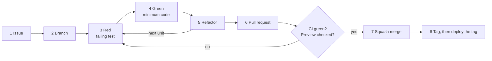

# Workflow

How a piece of work goes from idea to production. The same in every repo.



## 1. Every piece of work starts with an issue

- No issue, no code. If none exists, open one first. The issue is the description of the work.
- Use the form: **Feature** (users can see it), **Bug** (something is broken), **Task** (refactor, tooling, tests, infrastructure). Set the Issue Type. A larger effort is an **Epic** with sub-issues.
- **The title starts with the kind of work**, in brackets, from the list below: `[UI] Flight detail`. Do not write the issue type in the title. An epic has a plain name and no bracket. Decided by the owner ([D28](../decisions.md)).
- Attach it to its parent issue as a sub-issue when there is one.
- **Audit findings are issues.** When an audit of a repo finds a required rule not met, each finding is logged as a Task issue in that repo, as a sub-issue of one tracking issue. The audit skill does this itself. See [Agents](agents.md#auditing-a-repo).
- **An epic that changes data, server code, hosting, an outside service or a dependency starts with its architecture.** The target page and its decision records come before the first story. Proposed: see [Architecture](architecture.md).
- **Out-of-scope discoveries are filed, not fixed.** If you find something that should change but is not this task, open an issue and carry on. Reference it in a code comment if it matters right there: `// TODO: see #42`.

### Kinds of work

The type says what an issue is: a Feature, a Bug, a Task. The badge beside the title already shows it. The bracket says what kind of work it takes, which the type cannot. Under an epic, that is the difference between a list of thirty "Feature" rows and a list you can scan for the migrations.

| Prefix | The work is | Example |
| --- | --- | --- |
| `[UI]` | A screen or a component | `[UI] Flight detail` |
| `[Data]` | A table, a migration, a schema, the data layer | `[Data] Expenses and settlements` |
| `[Logic]` | A pure module with no screen | `[Logic] Ledger maths` |
| `[API]` | Server-side code: a function, a webhook, a scheduled job | `[API] Inbox ingest as an Edge Function` |
| `[Infra]` | The pipeline, the host, tooling, repo set-up | `[Infra] Leave Vercel` |
| `[QA]` | A test pass: accessibility, end-to-end, visual | `[QA] Accessibility pass` |
| `[Content]` | Copy or rules checked against a source | `[Content] Verify every rule line` |
| `[Docs]` | Documents only | `[Docs] README and CLAUDE.md updates` |
| `[DS]` | The design system, or adopting a release of it | `[DS] Add the warm tokens` |

- **One prefix per issue.** If a story needs two, name it for the part a user or reviewer would look at first. A story that adds a table and its screen is `[UI]`; the table is in its Architecture section.
- **The list is fixed.** A new kind is a change to this page, so the prefixes stay comparable across repos and on one project board.
- An item parked for later has no bracket until it is scheduled.

## 2. Branch from the issue

`feat/<issue>-short-slug` or `fix/<issue>-short-slug`. Example: `feat/12-share-page`.

Agents working in a cloud session use the branch the session assigns them.

## 3 to 5. Test first: red, green, refactor

Applies to every piece of logic. Layout, copy and styling changes are exempt. Any component with a condition or a computed value is logic.

1. **Red.** Write the failing test first, with a stub that compiles but returns the wrong answer. Run it. It must fail *for the reason you intended*, not because a file is missing.
2. **Green.** Write the minimum code that passes. Reach 100% coverage on the files you touched before moving on.
3. **Refactor.** Clean up with the tests green. No new behaviour.

The cycle is per unit of work, not per PR. One behaviour goes all the way round before the next starts.

Commit each phase. This is why quality gates run on push, not on commit: the red commit has to be committable.

More: [Testing](testing.md).

## Commits

Conventional commits, with the issue number at the end.

```
type(scope): short description (#issue)
```

| Type | Use for |
| --- | --- |
| `feat` | New behaviour |
| `fix` | A bug fix |
| `test` | Tests only. The red phase: `test(cart): red — empty cart totals zero (#9)` |
| `refactor` | No behaviour change |
| `docs` | Documentation only |
| `chore` | Tooling, dependencies, config |
| `ci` | Workflow files |

Examples:

```
test(cart): red — discount never drops the total below zero (#6)
feat(cart): green — clamp discounted total at zero (#6)
refactor(cart): extract price rounding (#6)
```

One repo writes the issue first, as `feat(#7): add wizard`. That is an accepted older form. New repos use the shape above.

## 6. Pull request

- **Title:** conventional commit style. It becomes the squash commit.
- **Body:** follow the PR template. It must contain:
  - `Closes #<n>` (or `Part of #<n>` when the issue stays open).
  - **Evidence it works at runtime.** Not "CI is green". What you ran, what you saw, and a screenshot for anything visible.
- **Version bump** in the PR when the repo is a deployed app and the change is user-facing. See [CI/CD](ci-cd.md#releases).
- **Docs** updated in the same PR when behaviour, structure, setup or conventions change.
- Open it ready for review, not as a draft, unless you are asking for early feedback.

### Before you ask for review

| Check | Command |
| --- | --- |
| Lint | `npm run lint` |
| Types | `npm run typecheck` |
| Tests and coverage | `npm run test:coverage` |
| Build | `npm run build` |
| End-to-end, if the repo has it | `npm run test:e2e` |
| It works in the running app | The repo's `verify` skill, or by hand |
| UI changes meet the [Front-end checklist](frontend-checklist.md) | Agent review against the checklist: Critical and High findings fixed |

### Answering review comments

1. Reply to the comment: what changed and why. If you disagree, say so and explain.
2. React: 👍 when the feedback was right, 👎 with a short reason when it does not apply.
3. Resolve the thread once the fix is pushed.

## 7. Merge

Squash merge when CI is green and the preview has been looked at. Delete the branch.

Never, to get a green check: skip, disable or delete a test. Lower a coverage threshold. Add a coverage exclusion without a written reason a reviewer would accept.

## 8. Release

Merging to `main` tags the merged commit, then deploys that tag. A bumped version gets `v<version>` and a GitHub Release; any other merge gets the next build tag, `v<version>+<n>`. Nothing is deployed by hand, and nothing untagged is deployed. Decided by the owner (D21); no repo runs it yet. See [CI/CD](ci-cd.md#releases).

## Planning

- Larger efforts are an **Epic** issue with sub-issues. Each PR links its issue.
- Issues carry Priority, Effort and Project fields on the roadmap board where the repo is on it.
- A **Spike** is a time-boxed question. Its output is a decision written into the issue, not code.
